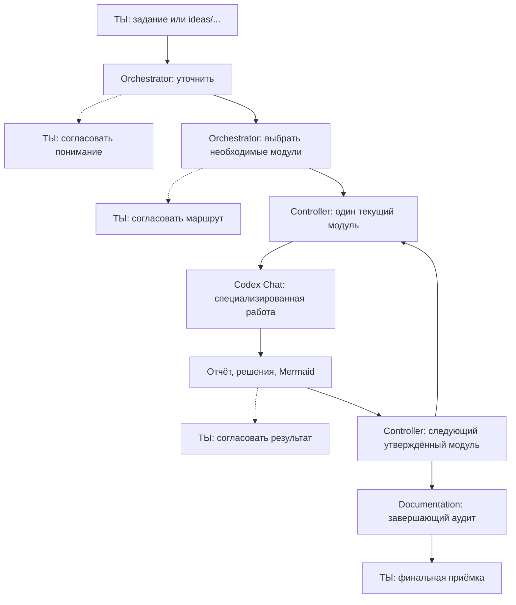

# Workflow — independent modules (v0.7)

This document is the shared protocol. Each `agents/*.md` file describes only its specialist. The module controller, not an LLM or a chat, enforces permissions and approvals.

## Two approvals BEFORE any specialists

1. **Understanding Gate.** Main Orchestrator asks necessary questions, states scope, exclusions, acceptance criteria and unresolved assumptions, then obtains the user's explicit approval. It cannot research or implement before approval.
2. **Route Gate.** Only then Orchestrator proposes a task-specific **ordered list of modules**. Show the roles, goals, necessary approved input artifacts, light/full System Design choice (if applicable), and Mermaid. The user separately approves. Never imply approval from silence, a file, or a model result.

## One independent module at a time

- Modules: `discovery`, `evals`, `planning`, `system_design`, `tasks`, `development`, `debugging`, `quality`, `documentation`. A module template may appear more than once with different IDs. Select only those useful for this task.
- Module `documentation` is mandatory and final. It audits the entire relevant documentation corpus against the real Git changes associated with this task, not just the latest commit. If nothing needs changing, provide concrete justification.
- A module receives **only its own role prompt, approved task brief, selected approved handoff files and accepted decisions**. It does not inherit other agents' transcripts and MUST NOT directly invoke another module.
- After finishing, each module returns a result, evidence, risks, user decisions and Mermaid. Main Orchestrator gives the user a concise review. **No following module starts until the user approves the current result.**
- A rejected result revises only the selected role inside the current module, preserving other role results. If the agreed route needs changing, first propose the revision and obtain a new human approval. Explicitly identify any already-approved outputs that would be superseded. Git edits do not roll back automatically.
- Documentation is the final handoff and final human acceptance gate.

## Boundaries

- **Main Orchestrator (AI):** understands, proposes the ordered route, summarizes and asks for approval. It cannot approve its own work.
- **Module Controller (deterministic code):** current module, transitions, approval tokens, validation, stored state, checkpoints and recovery.
- **Codex Bridge:** independent, named Codex chats for selected agents; not subagents. All transport events are routed back through the controller. Bridge never auto-approves permission escalations.
- **Modules:** own contract and agents, no knowledge of neighbor internals, no direct triggering of follow-on modules.
- Store: `.workflow/state.db` and `.workflow/runs/<run-id>/modules/<module-id>/handoff.md`; this is separate from chat history.

## Safety and verification

- Work is sequential between modules; within a module, agents are also run sequentially in one shared workspace to avoid write races.
- Actual editing and shell access require separate explicit CLI permissions; Linux shell isolation is fail-closed unless an informed unsafe override is specified. Codex sandbox permissions are negotiated separately and not silently escalated.
- On uncertain Codex turn, do not auto-retry; inspect the named thread and Git changes before manual recovery.
- `system_design` has `light` and `full` structural checklists; completeness is not proof of correctness.
- Reports distinguish actual observed actions from unverified or DEMO output.
- Orchestrator and role prompts are policy suggestions, NOT the technical enforcement mechanism. Human approval tokens are checked by code.

## What a stage looks like

*Diagram shows conceptual gates: the actual transition requires the corresponding explicit approval, not merely the arrow.*
