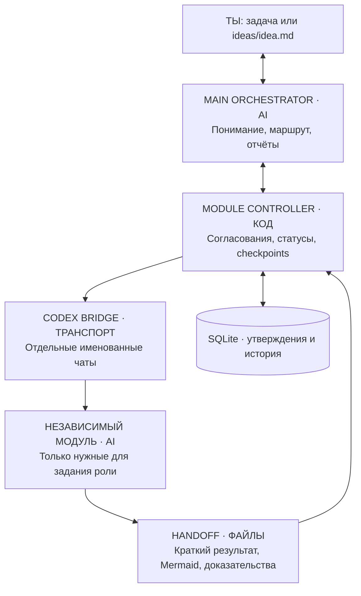
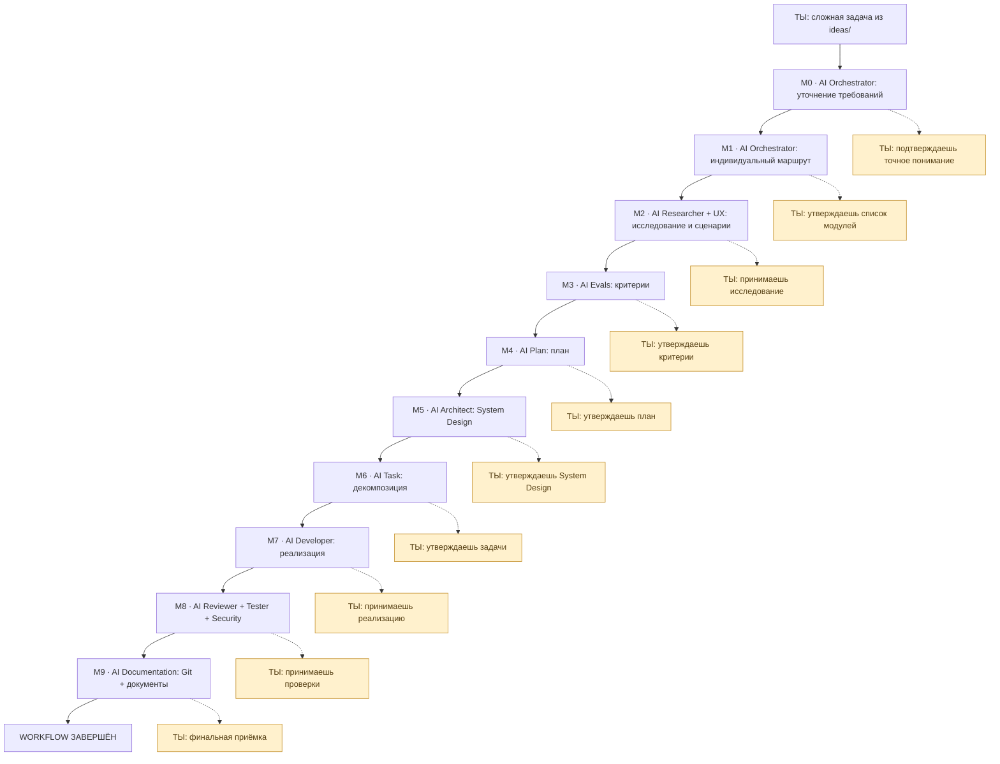
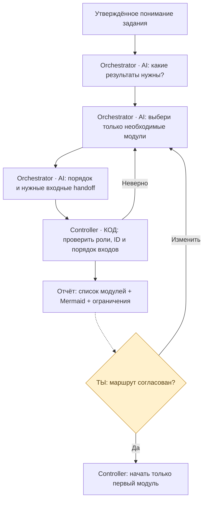
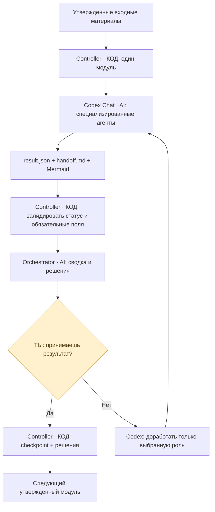
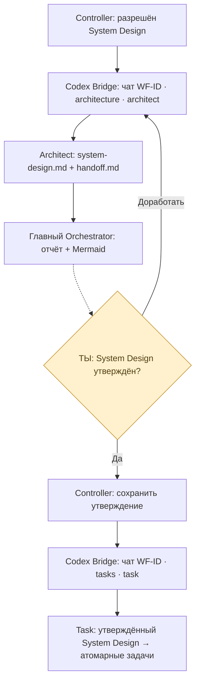
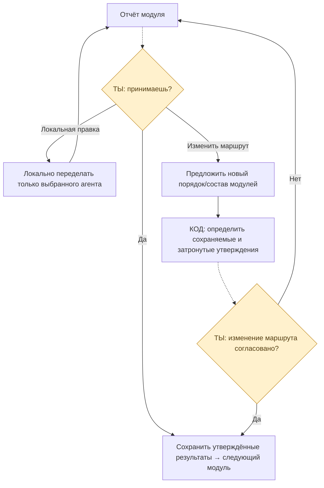
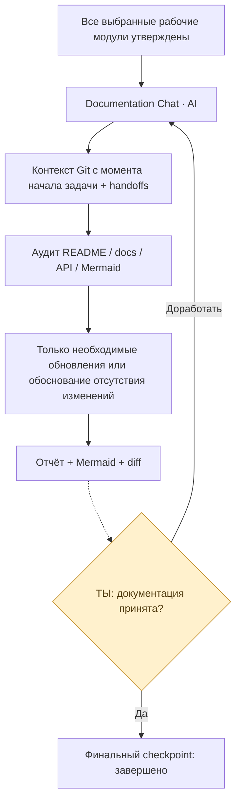

# Mermaid — Workflow v0.7 (Independent Modules)

## 1. Общая схема: три слоя

## 2. Полная сложная задача: слева тип модуля, справа согласование

Это **пример максимальной последовательности**, а не обязательный конвейер. Маршрут подбирает Orchestrator заново для каждого задания. Детерминированный Controller выполняет один выбранный модуль после утверждения результата предыдущего.

Сплошные переходы вниз разрешаются ТОЛЬКО после утверждения соответствующего пункта справа.

## 3. Динамический выбор модулей (не DAG)

## 4. Универсальный независимый модуль

## 5. Именованные чаты Codex: пример Architect → Task

## 6. Изменение после замечаний

## 7. Documentation всегда последний

